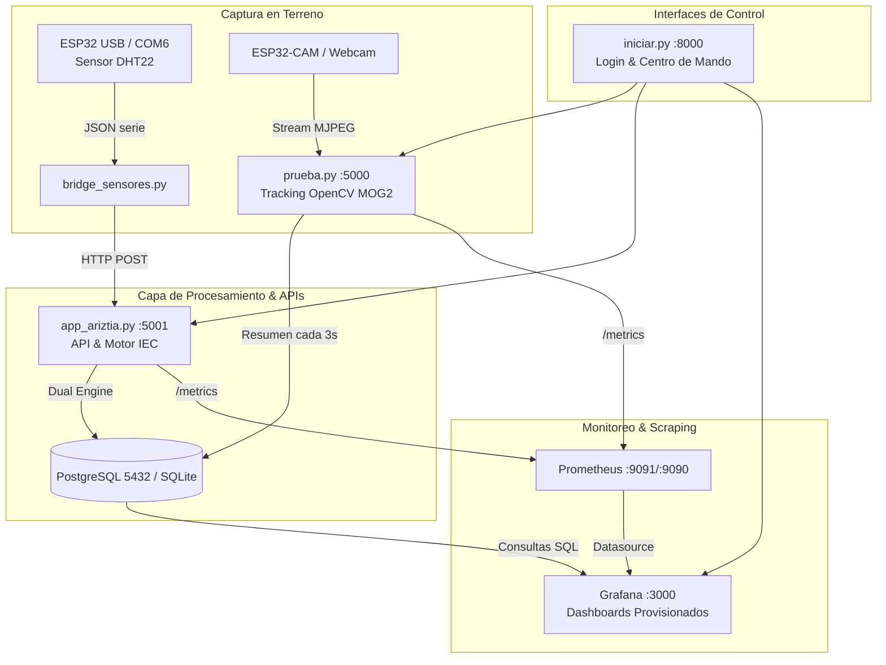

# 🐔 Ariztía IoT Core — Monitoreo Ambiental, Estrés Calórico & Tracking de Aves

[](https://www.python.org/)
[](https://opencv.org/)
[](https://flask.palletsprojects.com/)
[](https://www.postgresql.org/)
[](https://prometheus.io/)
[](https://grafana.com/)
[](https://www.espressif.com/)

Plataforma unificada de **Visión Artificial**, **Monitoreo Ambiental (IEC)** y **Telemetría Industrial** diseñada para optimizar las condiciones biológicas, el confort térmico y el bienestar animal en galpones avícolas de **Ariztía**.

---

## 🏗️ Arquitectura del Sistema



---

## 🚀 Características Principales

1. **Monitoreo Ambiental & Bioseguridad (IEC):**
   * Cálculo continuo del **Índice de Estrés Calórico** ($\text{IEC} = T^\circ\text{C} + \text{HR}\%$).
   * Muestreo objetivo de producción cada **60 segundos** con modo demo acelerado a **3 segundos**.
   * Clasificación automatizada en 4 niveles de riesgo (Confort, Precaución, Estrés Calórico y Crítico).
2. **Panel de Ensayos Operacionales Integrado:**
   * Inyección interactiva de escenarios:
     * 🟢 *Confort Normal (22–25.5 °C)*
     * 🟡 *Ensayo Advertencia (27–30 °C)*
     * 🔴 *Ensayo Crítico (>35 °C con alarma acústica/visual)*
     * ⚠️ *Filtrado y descarte de Lecturas Inválidas o corruptas*
     * 🔌 *Simulación de Caída de Conexión e intermitencia*
3. **Visión Computacional & Detección de Agrupamiento:**
   * Segmentación por sustracción de fondo adaptable (`cv2.createBackgroundSubtractorMOG2`).
   * Detección de concentración de aves (posible foco de frío, humedad o fallas de ventilación).
   * HUD en vivo con retícula táctica, tasa de cuadros (FPS) y alerta visual parpadeante tras 10 segundos continuos de aglomeración.
4. **Almacenamiento Dual & Resiliencia:**
   * **PostgreSQL (Docker 5432):** Motor relacional principal para paneles y tablas analíticas de Grafana.
   * **SQLite (`tracking.db`):** Failover transparente y automático si PostgreSQL no se encuentra en ejecución.
5. **Aprovisionamiento Automático en Grafana:**
   * Dashboard pre-configurado (`ariztia_dashboard.json`) con 8 paneles:
     * Gauges de Temperatura y Humedad con umbrales normativos.
     * Stat y barra de alerta cromática del IEC.
     * Historial de series temporales en vivo.
     * Tablas relacionales SQL de las últimas 30 lecturas ambientales y eventos de tracking.

---

## 📂 Estructura del Repositorio

```text
├── app_ariztia.py              # Backend Flask (5001), cálculo IEC y métricas Prometheus
├── prueba.py                   # Servicio de visión OpenCV (5000), tracking y MJPEG stream
├── bridge_sensores.py          # Puente serie USB auto-detectable para ESP32 (COM6)
├── database.py                 # Capa de datos dual con soporte PostgreSQL + SQLite
├── iniciar.py                  # Orquestador maestro integral para Windows/Linux
├── config_hardware.json        # Configuración centralizada de puertos, baudrate e IPs
│
├── login.html                  # Pantalla de acceso tecnológico con modo demo rápido
├── menu.html                   # Centro de mando unificado y monitor de salud de servicios
├── ariztia.html                # Dashboard ambiental con Chart.js interactivo y ensayos
├── tracking.html               # Visor HUD de video y telemetría de comportamiento
├── styles.css                  # Sistema de diseño SCADA industrial (Glassmorphism & Neon)
│
├── grafana_provisioning/       # Auto-provisioning de Grafana (datasources y tableros)
│   ├── dashboards/
│   │   ├── ariztia_dashboard.json
│   │   └── dashboards.yaml
│   └── datasources/
│       ├── postgres.yaml
│       └── prometheus.yaml
│
├── firmware_esp32/             # Código fuente para placa ESP32 (Arduino IDE)
│   └── firmware_esp32.ino
│
├── docker-compose.yml          # Despliegue de PostgreSQL y Prometheus en contenedores
├── Dockerfile                  # Contenedor de producción para app_ariztia
├── prometheus.yml              # Configuración de scrape local
├── prometheus-docker.yml       # Configuración de scrape en red Docker
├── requirements.txt            # Dependencias del entorno Python
└── README.md                   # Documentación técnica completa
```

---

## ⚡ Instalación & Puesta en Marcha

### Opción A: Inicio Completo con Orquestador (Recomendado en Windows)

1. **Clonar el repositorio:**
   ```bash
   git clone https://github.com/tu-usuario/proyecto-ariztia-iot.git
   cd proyecto-ariztia-iot
   ```

2. **Crear y activar el entorno virtual:**
   ```powershell
   python -m venv .venv
   .\.venv\Scripts\Activate.ps1
   ```

3. **Instalar dependencias:**
   ```powershell
   pip install -r requirements.txt
   ```

4. **Levantar base de datos e infraestructura (Opcional pero recomendado para Grafana):**
   ```powershell
   docker compose up -d
   ```

5. **Iniciar todo el ecosistema con un solo comando:**
   ```powershell
   python iniciar.py
   ```
   *El script levantará el servidor web, el servicio de visión, el backend ambiental, el puente serie y abrirá automáticamente el navegador en `http://localhost:8000/login.html`.*

---

## 🌐 Puertos y Endpoints del Sistema

| Módulo / Servicio | Puerto Local | Endpoint Principal | Descripción |
|---|---|---|---|
| **Centro de Mando** | `8000` | `http://localhost:8000` | Acceso (admin/admin) y estado de servicios |
| **Tracking Visión** | `5000` | `http://localhost:5000` | Feed MJPEG en vivo y métricas de visión |
| **Monitoreo Ambiental** | `5001` | `http://localhost:5001` | Panel IEC, curva térmica Chart.js y ensayos |
| **Métricas Ariztía** | `5001` | `http://localhost:5001/metrics` | Endpoint estándar para scraping de Prometheus |
| **Servidor Prometheus** | `9091` / `9090` | `http://localhost:9091` | Motor de consultas PromQL y targets |
| **Dashboard Grafana** | `3000` | `http://localhost:3000` | Tablero industrial provisionado `ariztia-iot` |
| **PostgreSQL** | `5432` | `localhost:5432` | Base de datos `ariztia_db` (user: `ariztia`) |

---

## 📊 Escala del Índice de Estrés Calórico (IEC)

| Rango IEC | Nivel | Significado Biológico | Acción Operacional Requerida |
|---|---|---|---|
| `< 95` | **Confort** | Condiciones térmicas óptimas | Registro estándar sin intervención |
| `95 – 104` | **Precaución** | Estrés térmico moderado | Alerta preventiva; encendido de extractores |
| `105 – 110` | **Estrés Calórico** | Riesgo de mortalidad y baja ingesta | Notificación con acuse de recibo y nebulización |
| `> 110` | **Crítico** | Sofocamiento inminente | Protocolo de emergencia y enfriamiento forzado |

---

## 🔌 Configuración de Hardware

Edita el archivo [`config_hardware.json`](file:///c:/Users/ale/Documents/codigo/config_hardware.json) para personalizar el hardware sin alterar el código fuente:

```json
{
  "sensores_esp32": {
    "puerto_com": "COM6",
    "baud_rate": 115200,
    "intervalo_lectura_segundos": 60
  },
  "camara_esp32_cam": {
    "fuente": "esp32",
    "ip_esp32_cam": "192.168.4.1",
    "puerto_stream": 81
  }
}
```

* Si no cuentas con sensor físico conectado, el sistema detecta la ausencia y activa automáticamente el modo de simulación de alta fidelidad.

---

## 📄 Licencia

Proyecto desarrollado para evaluación y monitoreo avícola industrial — **Ariztía**.
